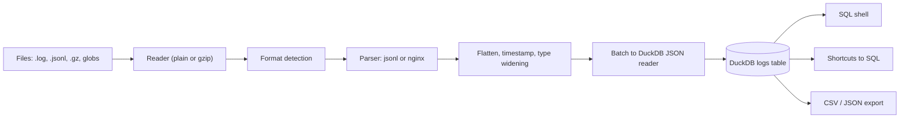

# LogSlice

**Turn large, messy log files into a table you can query with SQL, right in your terminal.**

LogSlice is a command-line tool for incident analysis. Point it at a JSON Lines or nginx/Apache access log (plain or gzipped). It detects the format, infers a schema, streams the data into an embedded [DuckDB](https://duckdb.org) database, and opens a SQL shell. Questions like "errors per minute" or "slowest endpoints" become one command instead of a pipeline of `grep`, `jq`, and `awk`.

```text
$ logslice access.log.gz
Format: nginx · 3,412,887 rows · 17 columns · ingested in 61.4s

logslice> rate status>=500 by 1m
logslice> slowest 10 by path
logslice> SELECT path, count(*) n FROM logs WHERE status = 404 GROUP BY 1 ORDER BY n DESC LIMIT 5;
```

(The row count and time above are illustrative. Measured results are in [docs/PERFORMANCE.md](docs/PERFORMANCE.md).)

## Contents

- [Problems it solves](#problems-it-solves)
- [Features](#features)
- [Supported formats](#supported-formats)
- [Installation](#installation)
- [Usage](#usage)
- [Shortcuts](#shortcuts)
- [SQL examples](#sql-examples)
- [Exporting results](#exporting-results)
- [Configuration](#configuration)
- [Architecture](#architecture)
- [Technology stack](#technology-stack)
- [Performance](#performance)
- [Testing](#testing)
- [Status and roadmap](#status-and-roadmap)
- [Contributing](#contributing)
- [License](#license)
- [Author and maintainer](#author-and-maintainer)

## Problems it solves

- "How many 5xx errors per minute, by endpoint?" normally means chaining `grep`, `jq`, `awk`, `sort`, and `uniq`, then redoing it for each follow-up question.
- JSON logs have nested and inconsistent fields, so `jq` filters break on missing keys.
- Large files are slow to scan again and again.
- Log platforms are great when logs are already shipped there, but not when you hold a file from a server, a customer, or a CI artifact.

LogSlice loads the file once and lets you ask as many questions as you like in SQL.

## Features

- **Automatic format detection** by scoring a sample of lines against each parser. Override with `--format`.
- **Streaming ingestion** in bounded-size batches, so LogSlice's own working memory follows the batch size, not the file size. An in-memory database still holds the loaded data. Use `--database` for data that should not live in RAM.
- **Gzip support**, detected from file contents rather than the extension. Truncated gzip files load whatever was readable and warn.
- **Schema inference** with nested JSON flattened to dot-notation columns (`http.status`), arrays kept as JSON text, and types widened as needed (integer, then double, then text).
- **Timestamp detection** by field name and value: ISO 8601 (with offsets), nginx time, and epoch seconds, milliseconds, microseconds, or nanoseconds. Normalized to a UTC `ts` column.
- **Malformed lines are kept**, not dropped: they become rows with the original text in `_raw` and are counted and sampled in the ingest report. Use `--drop-malformed` to skip them instead.
- **Interactive SQL shell** with multi-line statements, history, schema and stats commands, and result export.
- **Shortcuts** such as `top errors` and `rate by 1m` that run real SQL against the detected schema and print the SQL they ran.
- **Exports** to CSV, JSON, and JSON Lines, streamed so large results do not fill memory.
- **In-memory or persistent** databases (`--database logs.duckdb`).
- **Locked down after ingest**: SQL cannot read or write files on disk.

## Supported formats

| Format | `--format` | Notes |
|---|---|---|
| JSON Lines | `jsonl` (aliases `json`, `ndjson`) | One JSON object per line. Nested objects are flattened to a configurable depth (default 3). |
| nginx / Apache access log | `nginx` (aliases `apache`, `combined`) | `combined` and `common` layouts. A trailing number becomes `request_time`, and `key=value` tokens such as `rt=0.2` become columns. Apache's combined format is identical, so it parses too. |

Other formats (logfmt, custom regex) are planned. See the [roadmap](docs/ROADMAP.md).

## Installation

LogSlice needs Python 3.11 or newer. It is not published to PyPI yet. Install from the repository:

```bash
pipx install git+https://github.com/yagnang-vyas/log-slice.git
```

or from a clone, in a virtual environment:

```bash
git clone https://github.com/yagnang-vyas/log-slice.git
cd log-slice
python -m venv .venv && source .venv/bin/activate
pip install -e ".[dev]"
logslice --version
```

A `Dockerfile` is included:

```bash
docker build -t logslice .
docker run --rm -it -v "$PWD:/logs" logslice access.log
```

(The Dockerfile has not been built in the development environment because no Docker daemon was available there. CI builds it.)

## Usage

```bash
logslice access.log                          # nginx/Apache log, opens the SQL shell
logslice application.jsonl                   # JSON Lines
logslice access.log.gz                       # gzip is detected automatically
logslice 'logs/*.jsonl.gz'                   # globs and several files
logslice --format nginx access.log           # skip detection
logslice --database logs.duckdb access.log   # keep the loaded data in a file
logslice --database logs.duckdb              # reopen it later without re-ingesting
logslice access.log -q "status codes"        # one query, then exit
logslice access.log -q "top endpoints" -o top.csv
logslice access.log --schema --stats         # inspect what was inferred, then exit
logslice --help
logslice --version
```

Everything is loaded into one table called `logs`. Besides the fields in your data it has four standard columns:

| Column | Type | Meaning |
|---|---|---|
| `ts` | `TIMESTAMP` | Normalized event time in UTC, or `NULL` if none was found |
| `_file` | `VARCHAR` | Source file path |
| `_line` | `BIGINT` | Line number in the source file |
| `_raw` | `VARCHAR` | Original line, stored for malformed lines or with `--keep-raw` |

Inside the shell, end SQL with `;`. Shortcuts and `\` commands run immediately.

```text
\help  \schema  \stats  \shortcuts  \export FILE [QUERY]  \limit N  \history  \cancel  \quit
```

Full reference: [docs/CLI_REFERENCE.md](docs/CLI_REFERENCE.md). Exit codes: `0` success, `1` query or ingest failure, `2` usage error, `3` input error (missing file, undetectable format).

## Shortcuts

| Shortcut | What it does |
|---|---|
| `top errors [N]` | Most frequent error messages with numbers, hex, and UUIDs masked, so `timeout after 312ms` and `timeout after 87ms` group together |
| `top endpoints [N]` | Most requested paths with share and 5xx counts |
| `status codes` | Count and share per HTTP status |
| `rate by 1m` | Rows per time bucket (`s`, `m`, `h`, `d`) |
| `rate status>=500 by 1m` | Rows matching a condition per bucket |
| `slowest [N] [endpoints \| by COL]` | p50, p95, p99, and max duration per path or column |

Every shortcut accepts `where <condition>` and prints the SQL it ran.

Shortcuts do not assume one log format. They look for the columns that play each role (status, path, level, message, duration) by common names, such as `status`, `http.response.status_code`, `statusCode`, or `res.statusCode`, and tell you what they could not find. You can add your own names in the config file. Durations are converted to milliseconds: columns ending in `_ms` are taken as milliseconds, and `request_time` and similar as seconds (nginx's convention).

## SQL examples

```sql
-- Errors per minute for one endpoint
SELECT time_bucket(INTERVAL 1 MINUTE, ts) AS minute, count(*) AS errors
FROM logs WHERE status >= 500 AND path = '/api/orders'
GROUP BY 1 ORDER BY 1;

-- p95 latency by endpoint in a time window
SELECT path, count(*) AS n, quantile_cont(request_time, 0.95) AS p95
FROM logs
WHERE ts BETWEEN '2026-10-30 14:12' AND '2026-10-30 14:14'
GROUP BY path ORDER BY p95 DESC LIMIT 10;

-- Nested JSON fields are ordinary columns; quote names that contain dots
SELECT "http.path", count(*) FROM logs WHERE "http.status" = 500 GROUP BY 1;

-- The lines that failed to parse
SELECT _file, _line, _raw FROM logs WHERE _raw IS NOT NULL LIMIT 20;
```

## Exporting results

```text
logslice> \export slow.csv slowest 20
logslice> \export errors.json SELECT * FROM logs WHERE status >= 500;
```

or from the command line:

```bash
logslice access.log -q "status codes" -o codes.json
```

The format follows the file extension: `.csv`, `.json` (an array of objects), or `.jsonl`. Results are streamed to disk in chunks.

## Configuration

LogSlice works without configuration. Optional settings live in `~/.config/logslice/config.toml` (or `$LOGSLICE_CONFIG`) and in environment variables:

```toml
[ingest]
batch_size = 50000
flatten_depth = 3
keep_raw = false

[shell]
max_rows = 50

[aliases]
status = ["rc"]
duration_ms = ["took_millis"]
```

`LOGSLICE_MEMORY_LIMIT`, `LOGSLICE_THREADS`, `LOGSLICE_CONFIG`, and `LOGSLICE_HISTORY` are also supported. Details are in [docs/CONFIGURATION.md](docs/CONFIGURATION.md).

## Architecture



Each batch of rows is normalized in Python and loaded by DuckDB's native JSON reader. In a quick test during design, parameterized `INSERT` statements through the Python API managed under 7,000 rows per second, while DuckDB's JSON reader loaded the same 200,000 rows in about 0.1 seconds. That difference is why the design hands whole batches to the reader. More in [docs/ARCHITECTURE.md](docs/ARCHITECTURE.md).

## Technology stack

| Concern | Choice |
|---|---|
| Language | Python 3.11+ |
| Engine | DuckDB (the only runtime dependency) |
| CLI | `argparse` from the standard library |
| Shell | `input()` with `readline` history where available |
| Packaging | `hatchling`, `src/` layout, typed (`py.typed`) |
| Quality | `pytest`, `pytest-cov`, `ruff`, `mypy --strict` |
| CI | GitHub Actions on Linux, macOS, and Windows with Python 3.11 to 3.13 |

## Performance

Parsing happens in Python, so ingestion speed is bounded by one CPU core. On a 4-core Intel Xeon cloud VM, a generated 1 GB JSON Lines file (3.34 million rows) loaded in about 82 seconds, roughly 12 MB/s, and aggregate queries over it then ran in well under a second. The full numbers, hardware, and caveats are in [docs/PERFORMANCE.md](docs/PERFORMANCE.md). Run it yourself:

```bash
python tests/benchmarks/generate.py --format jsonl --size 1GB --out /tmp/bench.jsonl
python tests/benchmarks/run_benchmark.py /tmp/bench.jsonl
```

## Testing

```bash
pip install -e ".[dev]"
pytest                                # full suite, including large generated files
pytest -m "not slow"                  # skip the large-file tests
pytest --cov=logslice --cov-report=term-missing
ruff format --check . && ruff check . && mypy
```

See [docs/TESTING.md](docs/TESTING.md).

## Status and roadmap

Version 0.1 is implemented: JSONL and nginx/Apache parsing, schema inference, DuckDB ingest, SQL shell, shortcuts, and exports. Not yet implemented: logfmt and custom regex parsers, a terminal UI, Parquet export, live tailing, and Homebrew distribution. See [docs/ROADMAP.md](docs/ROADMAP.md) for what is done and what is planned.

## Contributing

Read [CONTRIBUTING.md](CONTRIBUTING.md) and the [Code of Conduct](CODE_OF_CONDUCT.md). New parsers and shortcuts are good first contributions. Report vulnerabilities as described in [SECURITY.md](SECURITY.md).

## License

MIT. See [LICENSE](LICENSE).

## Author and maintainer

LogSlice is written and maintained by **Yagnang Vyas** ([github.com/yagnang-vyas](https://github.com/yagnang-vyas)).
